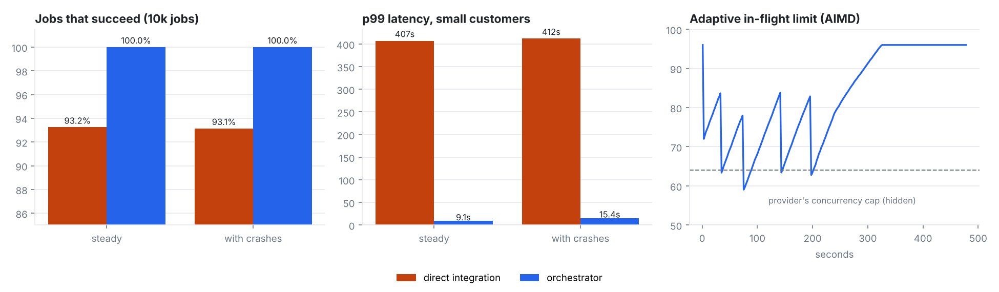

# Render orchestrator for the Magic Hour API

Fault-tolerant, multi-tenant job orchestrator for the Magic Hour generative-media API. On a 10k-job fault-injected load test it raised job success from 93.2% to 100%, eliminated all 271 duplicate paid renders, cut 429s by 99.9% and small-customer p99 latency by 45× (407 s → 9 s), and stayed exactly-once through kill -9 of workers and a full Redis wipe.

It sits between your product and the Magic Hour API and gets every customer's render done
exactly once, billed exactly once, and fairly, through rate limits, flaky upstream responses,
dropped webhooks and crashed processes.

**Stack:** Python 3.13, FastAPI, Postgres 16, Redis (Lua scripts), httpx/asyncio, multi-process
worker pool, Docker Compose. Includes a fault-injecting Magic Hour mock, a 10k-job load and chaos
harness, and unit tests for the core invariants.



## Results (10,000 jobs, same workload and same injected faults for both)

The workload has one customer dumping a 7,000-job backfill at t=0 while 30 small customers send
100 jobs each over four minutes. The mock Magic Hour enforces 40 req/s and 64 concurrent renders.
It injects 2% clean 5xx, 2% *ambiguous* 5xx (the project was created and billed but the client
gets an error), 1% hung requests, 3% render errors, 2% failed status checks, and drops 10% of
webhooks while duplicating 5%.

| | Direct integration (before) | Orchestrator | Change |
|---|---|---|---|
| Jobs succeeded | 93.2% (676 failed) | **100%** (0 failed) | +6.8 pts |
| Duplicate paid renders | 271 (1,355 credits wasted) | **0** | eliminated |
| 429s received | 5,049 | **5** | −99.9% |
| Status-check GETs | 15,015 | 1,337 | −91% (webhooks first) |
| Throughput | 954 jobs/min | **1,258 jobs/min** (75k/hr) | +32% |
| Small-customer p99 latency | 407 s | **9.1 s** | 45× faster |
| Ledger vs provider billing | n/a | **matches to the credit** (10,300 renders, 300 refunds) | |

**With crashes:** the orchestrator run also had a worker `kill -9`'d every 15 s (32 kills), the
reconciler killed, the API restarted, **Redis wiped with FLUSHALL**, and the whole worker pool
killed at once mid-submit. It still finished **100% (10,000/10,000), with 0 duplicate renders,
0 double charges, and a ledger equal to provider billing**. Small-customer p99 was 15.4 s and
throughput 1,234 jobs/min. The direct integration, killed once and restarted, finished at 93.1%
with 299 duplicate paid renders.

**Real Magic Hour API** (`results/real-api.json`): 12 image jobs (z-image-turbo, 640px, 60 credits
total) succeeded 12/12, all through the polling fallback. Every job was also submitted twice with
the same Idempotency-Key, and all 12 replays were deduped (12 projects created, not 24). Ledger
net = 60 credits = the sum of `credits_charged` that Magic Hour reports per project. p50 latency
was 19 s and p99 34 s.

Raw numbers are in `results/*.json` and the harness is `bench/loadtest.py`.

### What "direct integration" means

It's a reasonable first version, not a strawman (`bench/naive_client.py`). It runs a FIFO queue
with 64 concurrent jobs (tuned to the provider's cap), polls every 2 s, and retries failed creates
3 times with exponential backoff. It does not use Retry-After or idempotency, and keeps its
progress in a results file it resumes from after a crash. Most API integrations look like this.

## Resume bullet

> Built a multi-tenant render orchestrator for the Magic Hour generative-media API (FastAPI,
> Postgres, Redis/Lua, multi-process asyncio workers). Weighted fair queuing, AIMD rate
> limiting and a Postgres ledger + transactional outbox raised job success from 93.2% to 100%
> and cut small-customer p99 latency 45× (407 s → 9 s) on a 10k-job fault-injected load test.
> It eliminated all 271 duplicate paid renders and stayed exactly-once through kill -9 of
> workers and a full Redis wipe.

Shorter: *"Built a fault-tolerant render job orchestrator (FastAPI/Postgres/Redis) for the
Magic Hour API: 100% success vs 93% baseline, 0 double charges, 45× lower p99 for small tenants
across 10k jobs with injected failures and process crashes."*

## Architecture

```
 tenants ──POST /v1/jobs (Idempotency-Key)──▶  API (FastAPI)
                                                │  INSERT job (unique tenant+key)
                                                ▼
                    ┌──────────── Postgres (source of truth) ─────────────┐
                    │ jobs (CAS state machine, leases)  attempts           │
                    │ ledger unique(job,attempt,kind)   outbox             │
                    └──────────────────────────────────────────────────────┘
                                                │ index
                                                ▼
                    Redis (rebuildable): per-tenant queues, WFQ lanes, delayed
                    retries, token bucket, AIMD limit, global 429 pause
                                                │ Lua DEQUEUE
                                                ▼
          supervisor ─▶ N worker processes × M asyncio slots ──POST──▶ Magic Hour
                                                                         │
          API /webhooks/magic-hour ◀──── image.completed / errored ──────┘
          reconciler: poll fallback · lease reaper · outbox relay · Redis resync
```

**Job lifecycle:** `queued → submitting → rendering → succeeded`. Retryable failures go back to
`queued` with a backoff, and the job ends in `failed` after `MAX_ATTEMPTS`. Every transition is
one conditional `UPDATE ... WHERE status = <expected>` (plus `lease_owner` while a worker holds
the job). When a worker and the reaper race, or a webhook and the poller, exactly one wins.

### The parts that are hard

- **Exactly-once money.** Each provider project is one `attempts` row. Charges and refunds go
  into an append-only `ledger` with `UNIQUE(job_id, attempt, kind)`, in the same transaction as
  the state change. Duplicate webhooks, webhook/poll races, and a zombie worker reporting success
  after its lease was reaped all get the `ON CONFLICT DO NOTHING` path. The load test checks the
  ledger against the provider's own billing log after every run.
- **Ambiguous failures.** A timeout or 502 on create might mean the render exists and is
  billed. Retries of the same attempt reuse the same upstream idempotency key (`job:attempt`).
  A real render *error* mints a new key, since Magic Hour refunds those. This alone accounts for
  the 271 → 0 duplicate renders.
- **Fairness.** Start-time weighted fair queuing across tenants runs in a single Lua script,
  with priority lanes (interactive / standard / batch). A starvation guard gives the batch lane
  every 5th pick, and per-tenant in-flight caps scale by weight. A tenant returning from idle
  starts at the current virtual time, so it can't bank credit and flood the queue.
- **Rate limits.** A shared Redis token bucket covers request rate. An AIMD limit on concurrent
  renders (additive increase, ×0.75 on a 429, at most one decrease per second) finds the
  provider's hidden cap without being told. A single 429 also sets a global pause for
  Retry-After, so 64 workers don't each hammer the API on their own timers.
- **Crash recovery.** A worker holds a job only for the length of one submit call, under a
  lease. Once Magic Hour has accepted the render, completion arrives by webhook or poll, so
  killing a worker never strands a running render. The reaper requeues expired leases with the
  same upstream key. Redis is only an index: the reconciler rebuilds queues and in-flight
  counters from Postgres every 3 s, which is why `FLUSHALL` mid-run lost nothing (5,213 jobs
  re-indexed). The reconciler is leader-elected with a Postgres advisory lock, and you can run
  two for HA.
- **Webhooks first, polling as a fallback.** Webhooks are HMAC-verified and idempotent, and
  out-of-order delivery is fine. Renders with no webhook after `POLL_AFTER_S` are polled with
  exponential backoff. That's 91% fewer GETs than poll-only.
- **Transactional outbox.** `job.succeeded` and `job.failed` events are written in the same
  transaction as the state change and relayed at-least-once to a Redis stream and an optional
  tenant callback. Consumers dedupe on the outbox id.

## Run it

```bash
# natively (Postgres 16 + Redis running locally)
pip install -r requirements.txt
uvicorn mockmh.server:app --port 9000 &                 # fake Magic Hour (MOCK_WEBHOOK_URL=http://127.0.0.1:8000/webhooks/magic-hour)
uvicorn orchestrator.api:app --port 8000 &
MH_BASE_URL=http://127.0.0.1:9000 MAGIC_HOUR_API_KEY=mock python -m orchestrator.reconciler &
MH_BASE_URL=http://127.0.0.1:9000 MAGIC_HOUR_API_KEY=mock python -m orchestrator.supervisor &

curl -X POST localhost:8000/v1/jobs -H 'x-tenant-id: acme' -H 'idempotency-key: order-123' \
  -H 'content-type: application/json' \
  -d '{"endpoint":"/v1/ai-image-generator","priority":0,
       "payload":{"model":"z-image-turbo","image_count":1,"resolution":"640px","style":{"prompt":"a red fox"}}}'
curl localhost:8000/metrics

# or: docker compose up --build   (mock by default; set MH_BASE_URL + MAGIC_HOUR_API_KEY for the real API)

# tests and benchmarks
pytest -q tests                                   # 11 invariant tests (needs Postgres + Redis)
python -m bench.loadtest --system naive [--chaos]
python -m bench.loadtest --system orch  [--chaos]
python -m bench.real_run --jobs 12                # real API, ~60 credits
python -m bench.plot
```

All settings are environment variables (`orchestrator/config.py`): upstream RPS, burst, min and
max in-flight, per-tenant cap, attempts, backoff, lease, poll timings, and workers × slots.

## Honest caveats

- The mock compresses time (1.5 s median render instead of 30–90 s), so the jobs-per-hour figure
  shows scheduler capacity against those mock limits, not real-API throughput. The success-rate,
  duplicate, fairness and reconciliation results don't depend on render length.
- The **real Magic Hour API has no idempotency keys**, so a crash *between* the upstream create
  and the database commit can still produce one duplicate render there. The window is a single
  HTTP round trip, and the lease reaper narrows it, but it can't be closed from the client side.
  Supporting `Idempotency-Key` on POST endpoints would close it, and that's worth raising
  internally. Webhooks are configured in the dashboard, so the real-API run used polling only.
- The AIMD limit counts renders that are finished upstream but not yet acknowledged (webhook
  delay, or a dropped webhook waiting for its poll). That's why it settles above the provider's
  64 once the 429s stop.
- In-flight counters in Redis can drift briefly between resyncs (at most 3 s). Dynamic keys in
  the Lua scripts assume a single Redis node, not Redis Cluster.
- Docker files are included, but the benchmarks were run natively because this environment has
  no Docker daemon.

## Layout

```
orchestrator/  api.py  worker.py  supervisor.py  reconciler.py  scheduler.py (Lua)  db.py  schema.sql  provider.py  config.py
mockmh/        server.py        fault-injecting Magic Hour mock with a billing log
bench/         loadtest.py  naive_client.py  workload.py  real_run.py  plot.py
tests/         test_core.py     idempotency, CAS races, ledger exactly-once, leases, WFQ, lanes, AIMD
results/       *.json  summary.png
```
